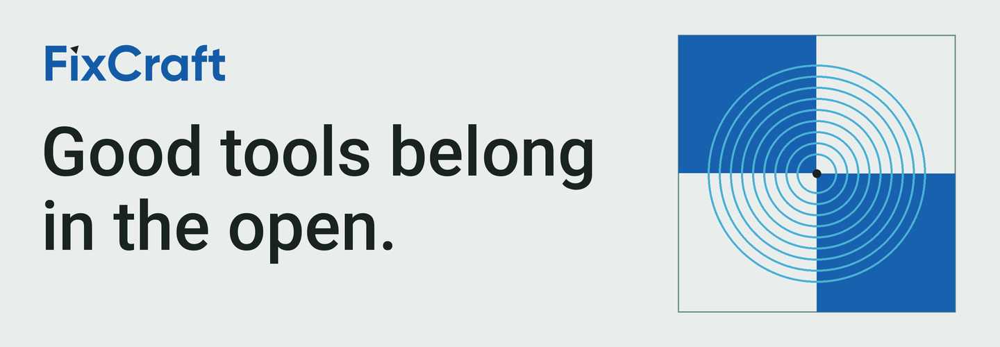

<picture>
  <source media="(prefers-color-scheme: dark)" srcset="assets/fixcraft-banner-dark.png">
  
</picture>

## Projects

- [YUME](https://github.com/FixCraft-Inc/yume) carries TCP, UDP, and IP traffic through a server you control. The Android VPN app is [yume4a](https://github.com/FixCraft-Inc/yume4a).
- [Ito](https://github.com/FixCraft-Inc/ito4a) is an Android app for end-to-end encrypted messages and audio calls over YUME. Its core, call relay, and mailbox live in [ito](https://github.com/FixCraft-Inc/ito).
- [Eclair](https://github.com/FixCraft-Inc/eclair) adds FP8, BF16, and int4 inference kernels to older NVIDIA GPUs such as the Tesla V100.
- [Watari](https://github.com/FixCraft-Inc/watari) runs Codex, Claude Code, OpenCode, and Qwen Code as one team in a Git checkout, where they exchange messages and hand off work.

Find project sites and the stories behind the names on the [FixCraft Projects page](https://www.fixcraft.org/projects).

## Contribute

Open an issue in the project you're using. For bug reports, include the version, platform, and steps to reproduce.
